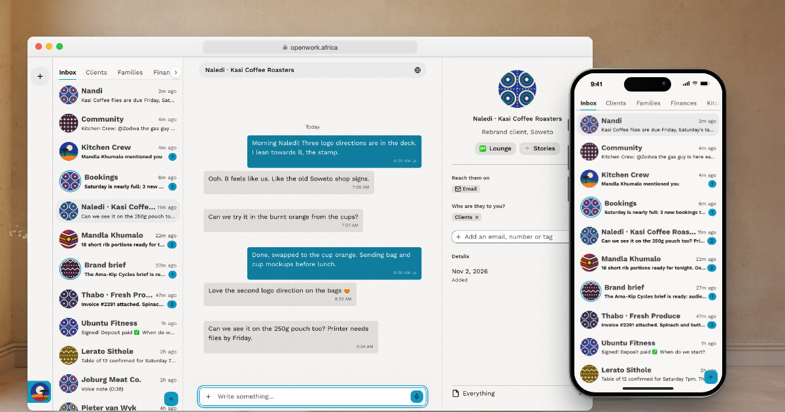

# Openwork

**An offline-first workspace for the people and operators you work with.**

[openwork.africa](https://openwork.africa)

## Why Openwork

A small business doesn't run on dashboards. It runs on conversations — with clients, suppliers, staff, and now AI operators. Those conversations are scattered across email, chat, spreadsheets and notebooks, and the tools built to hold them together are made for enterprises, not for the person running the shop.

Openwork brings them into one place on your own device: your people, your work and your operators in one list. It works offline, keeps your data on your machine, and treats an operator as just another member of the team you can talk to.

We're building it in the open because the people who need it most should be able to own it, run it, and change it.

## Run it

You need [Deno](https://deno.com) 2.9 and [Rust](https://rustup.rs) 1.88.

    deno task build
    cd server && cargo run -p ow-server -- --static ../app/dist

Then open <http://127.0.0.1:47410>. The server keeps your rooms, messages and pictures in `./data`; the page works
offline and syncs when the server is back.

To work on the app, run the Vite dev server beside the server. The dev server is on port 47411 and proxies the API to
the server on 47410:

    cd server && cargo run -p ow-server        # terminal 1
    cd app && deno task dev                    # terminal 2: http://127.0.0.1:47411

Checks: `deno task test`, `deno task lint`, `deno task check`, `deno task fitness`, and `cargo test` in `server/`.

## How it is built

Openwork is a **frame** plus **plugins**. The frame (`packages/*`) is the three-pane shell: the Circle (the room
list), the conversation window and the contact panel. It owns the design and exposes named **slots**: places such as
`circle.source`, `trail.body`, `trail.action` or `panel.section`. A plugin (`plugins/*`) contributes data to a slot (a
label, an icon, an order, a handler) and the frame draws it. A slot with nothing in it draws nothing.

What the app is made of is one file, `app/product.ts`: a list of plugins. This version ships `rooms`, `text` and
`profile`. Taking one out of the list is the whole uninstall; the rest still boots. A plugin can also open slots of its
own for other plugins to fill. [docs/plugins.md](docs/plugins.md) shows how to write one.

## Links

- Website: [openwork.africa](https://openwork.africa)
- Organization: [github.com/openwork-africa](https://github.com/openwork-africa)
