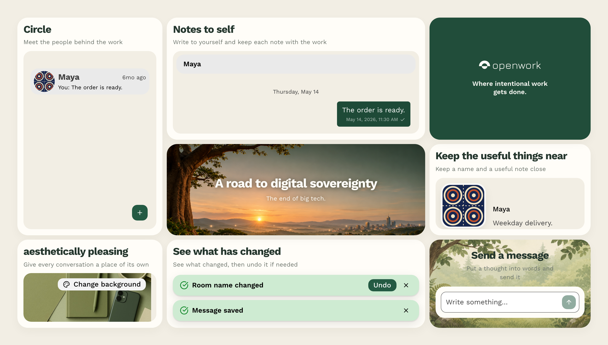

# Openwork

**An offline-first workspace for the people and operators you work with.**

[openwork.africa](https://openwork.africa)

## Why Openwork

A small business doesn't run on dashboards. It runs on conversations — with clients, suppliers, staff, and now AI operators. Those conversations are scattered
across email, chat, spreadsheets and notebooks, and the tools built to hold them together are made for enterprises, not for the person running the shop.

Openwork brings them into one place on your own device: your people, your work and your operators in one list. It works offline, keeps your data on your
machine, and treats an operator as just another member of the team you can talk to.

We're building it in the open because the people who need it most should be able to own it, run it, and change it.

## Getting started

Openwork currently has a Rust server and a TypeScript/React client. Deno manages the client workspace, checks, and test commands; Vite produces the browser
bundle. Rust builds and runs the server.

Install [Deno](https://deno.com) 2.9 and [Rust](https://rustup.rs) 1.88, then build and run the server from the repository root:

```sh
deno task build
cd server
cargo run -p ow-server -- --static ../app/dist
```

Open <http://127.0.0.1:47410>. The server keeps rooms, messages, and pictures in `server/data`; the page works offline and syncs when the server is available.

For local development, run the Rust API and the Vite client in separate terminals. Vite serves the app on port 47411 and proxies API requests to port 47410:

```sh
# Terminal 1, from the repository root
cd server && cargo run -p ow-server

# Terminal 2, from the repository root
cd app && deno task dev
```

Open <http://127.0.0.1:47411> while developing. After changing client code, rebuild with `deno task build` from the repository root.

Run the client checks from the repository root:

```sh
deno task check
deno task lint
deno task test
deno task fitness
```

Run the Rust server tests from `server/` with `cargo test`.

## How it is built

Openwork is a **frame** plus **plugins**. The frame (`packages/*`) is the three-pane shell: the Circle (the room list), the conversation window and the contact
panel. It owns the design and exposes named **slots**: places such as `circle.source`, `trail.body`, `trail.action` or `panel.section`. A plugin (`plugins/*`)
contributes data to a slot (a label, an icon, an order, a handler) and the frame draws it. A slot with nothing in it draws nothing.

What the app is made of is one file, `app/product.ts`: a list of plugins. This version ships `rooms`, `text` and `profile`. Taking one out of the list is the
whole uninstall; the rest still boots. A plugin can also open slots of its own for other plugins to fill. [docs/plugins.md](docs/plugins.md) shows how to write
one.

## Links

- Website: [openwork.africa](https://openwork.africa)
- Organization: [github.com/openwork-africa](https://github.com/openwork-africa)
