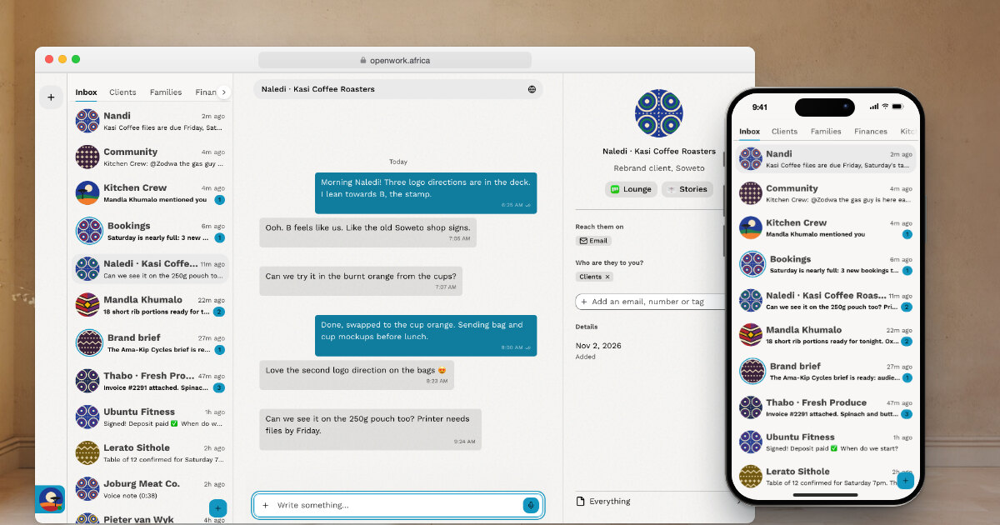

# Openwork

**An offline-first workspace for the people and operators you work with.**

[openwork.africa](https://openwork.africa)

## Why Openwork

A small business doesn't run on dashboards. It runs on conversations — with clients, suppliers, staff, and now AI operators. Those conversations are scattered across email, chat, spreadsheets and notebooks, and the tools built to hold them together are made for enterprises, not for the person running the shop.

Openwork brings them into one place on your own device: your people, your work and your operators in one list. It works offline, keeps your data on your machine, and treats an operator as just another member of the team you can talk to.

We're building it in the open because the people who need it most should be able to own it, run it, and change it.

## Open source is coming

The source code is on its way — this repository is where it will live. Watch or star the repo to hear when the first release lands.

## Links

- Website: [openwork.africa](https://openwork.africa)
- Organization: [github.com/openwork-africa](https://github.com/openwork-africa)
